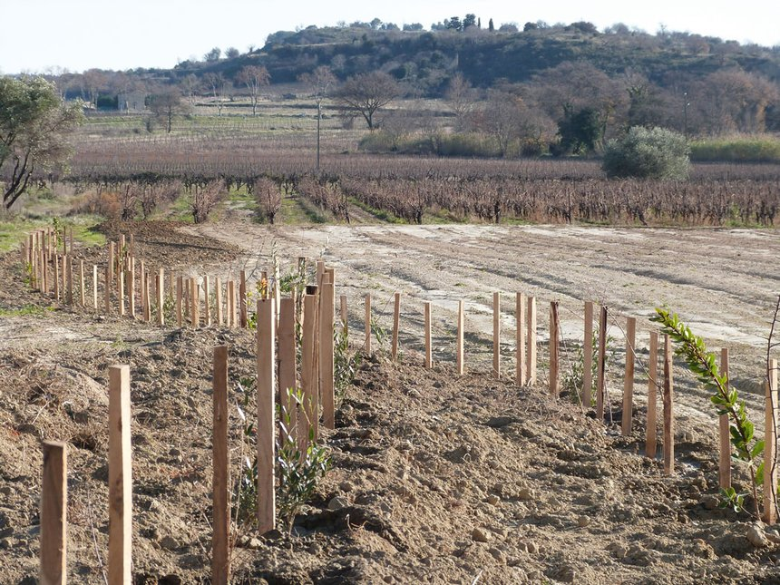

Dans la cadre du plan de relance, le minsistre de l'Agriculture a lancé le programme "**Plantons des haies"**. Ce programme a pour objectif d’aider les agriculteurs qui souhaitent favoriser la biodiversité autour et à l'intérieur de leurs cultures en **reconstituant les haies bocagères** qui les entourent et en implantant des alignements d'arbres (agroforesterie intraparcellaire).

 <!--more-->
 
**En Occitanie, 5 millions d'euros d'aides sont accessibles**. Les périodes de dépots de candidatures sont possibles:

  * du 15/02/2021 au 15/04/2021
  * du 16/04/2021 au 30/06/2021

Les dossiers sont à faire dans le cadre des [PCAE "Type d’Opération 4.1.3 Investissements en faveur d’une gestion qualitative et quantitative de la ressource en eau"](https://www.europe-en-occitanie.eu/IMG/pdf/09_annexe_aap_4.1.3_lr_cp-fev21.pdf) pour le Languedoc-Roussillon. Sont éligibles aux aides: Matériel végétal, paillage biodégradable, gaines de protection des plants, travaux de préparation du sol et de plantation, clôture pour la mise en défense de la plantation.  
**Le viticulteur peut donc se faire subventionner la plantation des haies effectuée par un prestataire.**

**Le taux d'aide publique de base est de 80% du montant HT**

<!--more-->

Dépenses sont plafonnées à 1500 € HT/100 ml dans le cas général, à 3000 € HT/100 ml si nécessité de réaliser en plus un soussolage avec destruction d'encroutement calcaire ou bancs rocheux. 

Les projets de plantation de haies éligibles en Occitanie correspondent à l**’implantation de haies non mono-spécifiques à base d’arbres forestiers, champêtres et de fruitiers**(non destinés à la production agricole) implantées en bordure de parcelles agricoles ou en intra-parcellaire. Les projets d’agroforesterie qui peuvent bénéficier d’une aide correspondent à l'association, au sein d'une même parcelle, d'une production agricole avec un peuplement d'arbres à faible densité.

La plantation d'essences forestières peut être complétée par la plantation d'autres espèces d'arbres, comme les arbres fruitiers ou des arbres à valorisation multiple (à la fois fruit et bois). Seront favorisées les espèces et variétés locales, ainsi que celles qui sont favorables à la biodiversité (par exemple celles qui fournissent des ressources alimentaires aux pollinisateurs), à la lutte contre l'érosion, à la protection contre le vent…

[Le cahier des charges](https://www.laregion.fr/IMG/pdf/cdc_regional_haies-agroforesterie_v20210215.pdf) n’impose pas de linéaire minimum mais le plancher de dépenses à 1000€ s’applique à tous les projets.

Pour remplir vos dossiers de subvention, [les chambres d'agriculture peuvent vous aider comme celle du gard par exemple. ](https://gard.chambre-agriculture.fr/actualites/detail-de-lactualite/actualites/mesure-plantons-des-haies/)

En Midi-Pyrénées, les viticulteurs doivent passer par d'autres mesures TO 4.4.1 « Investissements non productifs pour la préservation de la biodiversité » et 8.2.1 « Opérations d’installation de systèmes agro-forestiers » du PDR Midi-Pyrénées.

---
Publication originale: [https://www.tema-agriculture-terroirs.fr/mon-viti/vie-de-lentreprise/plantons-des-haies-subventionne-a-hauteur-de-80-les-plants-mais-aussi-la-plantation-par-un-tiers-855850.php](https://www.tema-agriculture-terroirs.fr/mon-viti/vie-de-lentreprise/plantons-des-haies-subventionne-a-hauteur-de-80-les-plants-mais-aussi-la-plantation-par-un-tiers-855850.php)
