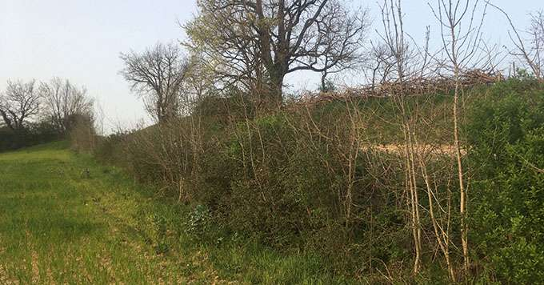
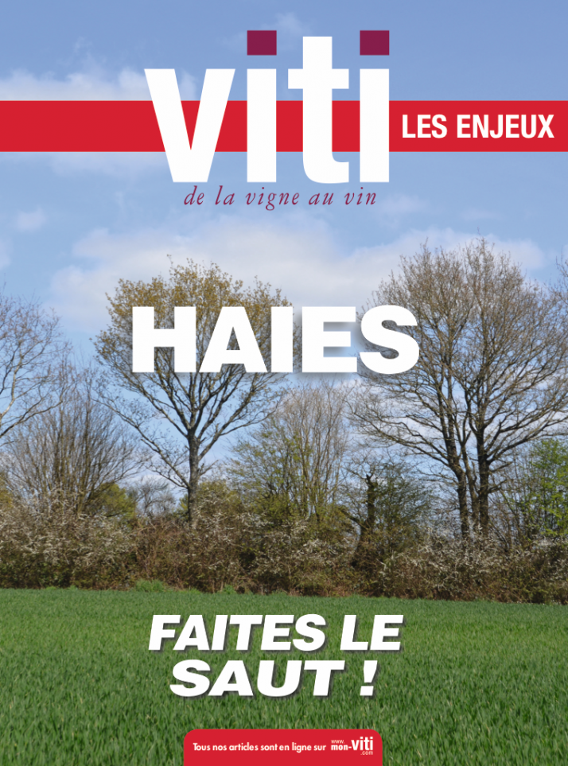

Michel Maestrojuan teste sur son domaine vitcole gersois l'implantation de haie de Benjes, autrement appelée « une haie morte ». Elle est constituée de grandes branches d’arbre empilées et stabilisées par des pieux.

<!--more-->

«Mon projet intègre l’agrandissement des linéaires de haies qui courent actuellement sur près de 3 km. Il y a trois ans, **j’ai arrêté de broyer un talus sur lequel il y avait historiquement une haie** , il y a plus de 50 ans. Sur ce tronçon de 100 mètres, j’ai misé sur la régénération naturelle. Des frênes, des chênes, des troènes, des ormeaux ont déjà conquis l’espace. Les essences sont variées et certains arbres dépassent les deux mètres de haut. Cet hiver, j’ai par ailleurs mis en place **une haie Benjes sur 15 mètres** », explique Michel Maestrojaun, exploitant de 60 ha de céréales et également vigneron propriétaire du domaine Entras, dans le Gers.

### 3,35 euros de reste à charge

La haie de Benjes, autrement appelée « une haie morte », est constituée de grandes branches d’arbre empilées et stabilisées par des pieux. L’idée est que les oiseaux, en se posant dessus, y défèquent des graines, futurs arbres et arbustes qui prendront la place de la structure ligneuse biodégradable et donc éphémère.  
« Le concept est intéressant et je voulais le tester. Mais que le montage est fastidieux ! Il m’a fallu près de dix heures de travail. » À côté de ces deux modalités de régénération spontanée, le vigneron a planté 800 mètres de haies. « Arbre et Paysage 32 (AP 32) m’a accompagné pour trouver des aides, gérer l’administration des dossiers, commander les plants et me conseiller. Mon reste à charge était de 3,35 euros TTC le mètre linéaire desquels je peux déduire une aide complémentaire de 1 euro délivrée par la fédération des chasseurs. 2,35 € pour les plants, le paillage en amidon de maïs, les protections et le travail des techniciens de l’association ; c’est raisonnable. Mais ce coût ne prend pas en compte la préparation du sol et surtout la plantation. Heureusement, j’ai pu compter sur le soutien de cinq bénévoles mobilisés par AP 32 en renfort de mes cinq salariés. Le coût salarial de la journée de plantation a été divisé par deux et le chantier collectif s’est révélé un très bon moment de convivialité et de partage. Les haies et la vie qu’elles hébergent me réjouissent et m’encouragent à aller encore plus loin mais je n’omets pas la charge qu’elles représentent à l’entretien. Sur mon exploitation elles ne rapportent rien directement. J’attends qu’une aide soit créée pour rémunérer la séquestration carbone. Ce serait un moyen d’encourager à planter surtout dans les filières qui génèrent moins de valeur que la viticulture. »

Article paru dans Viti Les Enjeux n°34 de mai 2021 

---
Publication originale: [https://www.tema-agriculture-terroirs.fr/mon-viti/viticulture/jai-teste-la-haie-de-benjes-852014.php](https://www.tema-agriculture-terroirs.fr/mon-viti/viticulture/jai-teste-la-haie-de-benjes-852014.php)
