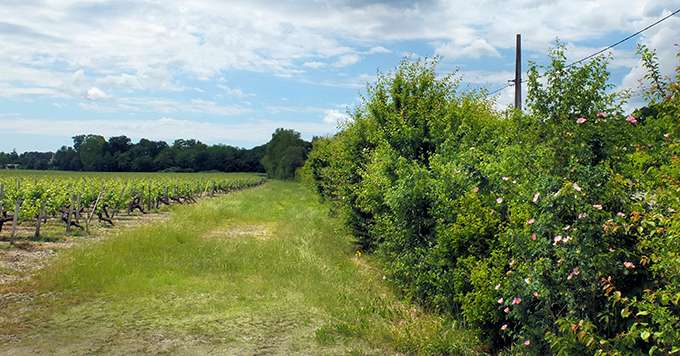

Le nouveau Pacte en faveur de la haie remis en avant par le Gouvernement en mars met en lumière une pratique trop peu connue : la régénération naturelle de haies.

<!--more-->
_© DR_

Le nouveau Pacte en faveur de la haie remis en avant par le Gouvernement en mars met en lumière une pratique trop peu connue : la régénération naturelle de haies. En effet, plutôt que de planter une haie, on peut compter sur la **végétation «** **spontanée** **»** qui se développe naturellement en bordure de parcelle. 

Une haie issue de **régénération naturelle** présente de nombreux atouts. Elle est par exemple gratuite en travail comme le détaille Bruno Sirven, chef de projets chez Arbre et Paysage 32, dans l'article [Laisser faire la nature pour restaurer des haies](https://www.tema-agriculture-terroirs.fr/mon-viti/vie-de-lentreprise/laisser-faire-la-nature-pour-restaurer-des-haies-852009.php).

Dans le Gers, Michel Maestrojuan pratique la régénération naturelle des haies. Il a aussi mis en place une **haie de Benjes** , autrement appelée « une haie morte », constituée de grandes branches d’arbre empilées et stabilisées par des pieux. L’idée est que les oiseaux, en se posant dessus, y défèquent des graines, futurs arbres et arbustes. 

**> >> À lire :[ J'ai testé la haie de Benjes](https://www.tema-agriculture-terroirs.fr/mon-viti/viticulture/jai-teste-la-haie-de-benjes-852014.php)**

Autre possibilité pour**créer une haie sans plantation** **: le plessage.** Le plessage consiste à entailler de manière oblique le tronc de l’arbuste, près du sol, pour le plier, le coucher en direction de l’arbre voisin. Ils sont tressés de part et d’autre de fins piquets placés tous les 30 à 50 cm et forment ainsi une haie linéaire. 

**> >> À lire : [Plessage : créer une haie sans la planter](https://www.tema-agriculture-terroirs.fr/mon-viti/viticulture/plessage-creer-une-haie-sans-la-planter-852342.php)**

Opter pour la régénération naturelle permet-elle en revanche d'anticiper le changement climatique ? Les haies vont rester en place dix, vingt ou quarante ans. Certains conseillent de planter des espèces non locales. Mais il n'y a pas consensus.

**> >> À lire : [Pour les haies, quid du changement climatique](https://www.tema-agriculture-terroirs.fr/mon-viti/viticulture/quid-du-changement-climatique-852002.php)** **[?](https://www.tema-agriculture-terroirs.fr/mon-viti/viticulture/quid-du-changement-climatique-852002.php)**

---
Publication originale: [https://www.tema-agriculture-terroirs.fr/mon-viti/viticulture/la-regeneration-naturelle-une-solution-pour-des-haies-locales-893990.php](https://www.tema-agriculture-terroirs.fr/mon-viti/viticulture/la-regeneration-naturelle-une-solution-pour-des-haies-locales-893990.php)
