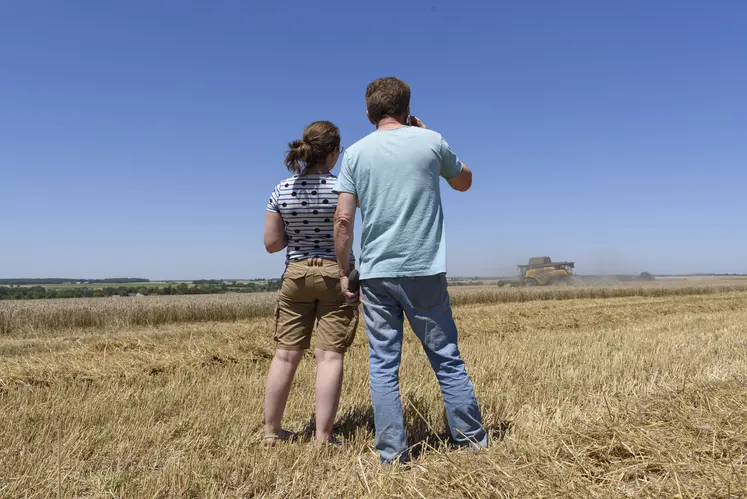

<!--more-->

## S'installer en viticulture, le parcours du combattant ?

### Environ 1300 personnes par an réussissent à s’installer en viticulture

Qu’il s’agisse d’une reprise hors cadre familiale ou d’une [transmission](https://www.reussir.fr/vigne/transmission?utm_source=article&utm_medium=body&utm_campaign=3c9dcf8b-be6c-411d-bd7d-f46e5ce94917), chaque parcours d’[installation](https://www.reussir.fr/vigne/installation?utm_source=article&utm_medium=body&utm_campaign=3c9dcf8b-be6c-411d-bd7d-f46e5ce94917) est unique. Les quelque 1 300 futurs viticulteurs et viticultrices qui concrétisent chaque année leur projet agricole ont toutefois un point commun : leur itinéraire administratif.

Lire aussi : [Bien préparer la vente d’une propriété viticole](https://www.reussir.fr/vigne/bien-preparer-la-vente-dune-propriete-viticole?utm_source=article&utm_medium=body&utm_campaign=3c9dcf8b-be6c-411d-bd7d-f46e5ce94917)

### S'installer en viticulture : des étapes précises à respecter

L’installation, avec **création d’entreprise**, obéit à un parcours institutionnel balisé par des organismes publics et privés. Dans la liste, on retrouvera : la MSA, la DDT, les Douanes, l’interprofession, la [Safer](https://www.reussir.fr/vigne/safer?utm_source=article&utm_medium=body&utm_campaign=3c9dcf8b-be6c-411d-bd7d-f46e5ce94917), FranceAgriMer, le centre des Impôts...

Les démarches obligatoires à mettre en œuvre auprès de telle ou telle structure sont souvent interdépendantes. Il existe donc **un ordre optimal dans les formalités administratives à engager.**

### S'installer en viticulture : se doter d'un espace numérique

Avec la dématérialisation des procédures administratives, il est désormais impossible de s’installer sans avoir à disposition une connexion Internet, un ordinateur et une adresse e-mail. Pour faciliter la constitution de nombreux dossiers demandés, il est conseillé de créer un dossier (encore un !) numérique où stocker tous vos documents. Numérisez votre carte d’identité et tous les documents papier en votre possession (baux, plan de cuverie...). Nommez clairement chaque document.

## Le Point Accueil Installation : un premier pas pour s’installer en viticulture

### Le Point Accueil Installation est un service gratuit

**Les Points Accueil Installation** de chaque département sont de bonnes portes d’entrée lorsque l’on souhaite s’**installer en viticulture**. Ce service gratuit est accessible à tous les futurs installés, quel que soit leur âge et le niveau d’avancement de leur projet. Contrairement à une idée reçue, les conseillers des **Point Accueil Installation** ne sont pas uniquement là pour les installations aidées (1). Un porteur de projet qui ne sollicitera ni [dotation jeune agriculteur](https://chambres-agriculture.fr/je-suis-futur-agriculteur/construire-son-projet-dinstallation/financement) (DJA), ni dotation nouvel agriculteur (DNA) peut prendre rendez-vous, recevoir des conseils individualisés et être guidé dans les démarches administratives à effectuer.

Lire aussi : [Les repreneurs d’exploitations viticoles se diversifient](https://www.reussir.fr/vigne/les-repreneurs-dexploitations-viticoles-se-diversifient?utm_source=article&utm_medium=body&utm_campaign=3c9dcf8b-be6c-411d-bd7d-f46e5ce94917)

### Rechercher sur le web le Point Accueil Installation selon sa région

Cette mission de service publique est portée par une structure labellisée par le préfet de Région. D’un département à l’autre, la structure labellisée **Point Accueil Installation** diffère. Il peut s’agir de **la chambre d’agriculture départementale, du syndicat des Jeunes Agriculteurs, de l’Adasea**... Il n’existe pas d’annuaire national des PAI. Une requête sur un moteur de recherche Internet permet d’identifier le PAI de son département.

Lire aussi : [Transmission viticole : « L’anticipation est essentielle »](https://www.reussir.fr/vigne/transmission-lanticipation-est-essentielle?utm_source=article&utm_medium=body&utm_campaign=3c9dcf8b-be6c-411d-bd7d-f46e5ce94917)

Le passage au **Point Accueil Installation** revêt en revanche **un caractère obligatoire dans le cadre d’une demande de dotation jeune agriculteur** (DJA). L’obtention de cette aide, désormais gérée par les régions, nécessite la réalisation d’un Plan de Professionnalisation Personnalisé (PPP) encadré par les PAI.

Lire aussi : [Créer une exploitation viticole hors cadre familial](https://www.reussir.fr/vigne/creer-une-exploitation-viticole-hors-cadre-familial?utm_source=article&utm_medium=body&utm_campaign=3c9dcf8b-be6c-411d-bd7d-f46e5ce94917)

## Le contrôle des structures : un laisser-passer pour s’installer en viticulture

### Le contrôle des structures : répondre au questionnaire de la DDT

**La direction départementale des territoires** (DDT) est un interlocuteur incontournable, à solliciter dès lors que son projet d’installation est abouti. Pour le compte des Régions, chaque DDT concrétise les orientations politiques concernant **l’installation** et la **transmission** d’exploitations via le **contrôle des structures**. Charge aux **viticulteurs** et viticultrices en devenir de vérifier s’ils sont soumis à une **autorisation d’exploiter** en répondant à un questionnaire téléchargeable en ligne sur le site de toutes les DDT.

Lire aussi : [Pluriactivité et contrôle des structures](https://www.reussir.fr/vigne/pluriactivite-et-controle-des-structures?utm_source=article&utm_medium=body&utm_campaign=3c9dcf8b-be6c-411d-bd7d-f46e5ce94917)

### Le contrôle des structures : réaliser la demande si dépassement du seuil de la surface de vigne

La **surface de vigne** exploitée est le critère principal pour justifier une demande. Si cette dernière dépasse le seuil de viabilité ou le seuil d’agrandissement fixés par le schéma directeur des exploitations agricoles de sa Région, une demande est à constituer. La ou les surfaces seuils sont propres à chaque département. Et dans certains **vignobles**, comme en Bourgogne, une surface seuil de viabilité est associée à chaque appellation. 

Lire aussi : [Coup de frein sur les ventes de vignes en 2023](https://www.reussir.fr/vigne/coup-de-frein-sur-les-ventes-de-vignes-en-2023?utm_source=article&utm_medium=body&utm_campaign=3c9dcf8b-be6c-411d-bd7d-f46e5ce94917)

### Le contrôle des structures : liste des documents à fournir pour la demande d’autorisation d’exploiter

Dans le cas où le projet d’installation nécessite une demande d’autorisation d’exploiter, un dossier est à constituer auprès de la DDT. Plusieurs pièces administratives sont à fournir et la production de certaines nécessite l’intervention d’un tiers, notamment :

*   Les lettres d’information aux **propriétaires des biens/parcelles** à reprendre pour exploitation. Ces documents préremplis sont à envoyer à tous les propriétaires concernés, même s’il s’agit d’une succession familiale. Pour le dossier DDT, une version signée ou l’accusé de réception du courrier sont demandés. Un [modèle de lettre d’information](https://www.charente.gouv.fr/contenu/telechargement/44984/370455/file/DDT16_Lettre_d_information_au_proprietaire.pdf) est en ligne sur les sites Internet des DDT.

*   Les statuts de l’entreprise si l’installation se fait sous forme sociétaire (Gaec, SCEA, EARL...). Les entreprises individuelles en sont exemptées.

« *Il est recommandé de confier la rédaction des statuts à un professionnel comme un juriste, un notaire ou un avocat*, indique Solenne Labbé, juriste au sein du CGO, une association de gestion et de comptabilité implantée en Nouvelle-Aquitaine. Une fois les statuts rédigés et adoptés, [une annonce légale d’avis de création](https://entreprendre.service-public.gouv.fr/vosdroits/F35957) de société doit, dans certains cas, être publiée[dans un support habilité](https://entreprendre.service-public.gouv.fr/vosdroits/R44934) ». [Le prix des annonces légales est fixé](https://www.service-public.gouv.fr/simulateur/calcul/tarifsAnnoncesLegales) par les pouvoirs publics. Comptez 264 euros pour la création d’une EARL ou d’une SCEA. Pour un Gaec, l’annonce n’est pas obligatoire.

Lorsque le dossier d’**autorisation d’exploiter** est constitué, la liasse documentaire est alors à transmettre par courrier avec accusé de réception ou par téléprocédure (2) à la DDT de son département. S’il n’y a pas de concurrence sur les terres à exploiter, le délai d'instruction par la DDT est de 4 mois et court à compter de la date de notification de la complétude du dossier. L'absence de réponse après ce délai vaut acceptation de la demande.

Lire aussi : [« Je me suis installée en viticulture en profitant d’un stage de parrainage financé par la région »](https://www.reussir.fr/vigne/je-me-suis-installee-en-viticulture-en-profitant-dun-stage-de-parrainage-finance-par-la-region?utm_source=article&utm_medium=body&utm_campaign=3c9dcf8b-be6c-411d-bd7d-f46e5ce94917)

### Le contrôle des structures : les délais pour l’obtention de l’autorisation

S’il y a mise en concurrence la commission départementale d'orientation de l'agriculture (CDOA) devra statuer. Le délai pour obtenir l’autorisation d’exploiter est alors de 6 mois.

« *Pour les porteurs de projets concernés par l’autorisation d’exploiter ces quelques mois d’attente sont à mettre à profit pour entamer d’autres formalités*, conseille Solenne Labbé. *Il s’agit par exemple d’aller s’assurer de l’accord de tous les propriétaires de parcelles concernées par les lettres d’information, de rédiger les **baux**, de commencer les formalités relatives aux **bulletins de mutation** MSA. »*

Une fois l’autorisation d’exploiter acquise, il est temps d’enregistrer son entreprise sur le Guichet Unique des Entreprises (GUE).

## Un guichet unique pour simplifier les démarches lorsqu’on souhaite s’installer en viticulture

### Que permet le Guichet Unique des Entreprises ?

Depuis 2023, le [Guichet Unique des formalités d’entreprises](https://www.inpi.fr/decouvrir-inpi/formalites-dentreprises/guichet-unique-formalites-dentreprises-et-registre-national-entreprises), géré par l'INPI, est la plateforme en ligne des entreprises. Elle centralise toutes les formalités de création, modification et cessation d'activité.

Cette nouvelle démarche obligatoire va automatiquement mettre en relation le porteur de projet avec plusieurs organismes :

- **le répertoire national Sirene** pour le numéro Siret de l’entreprise,
- **les Impôts** pour le numéro de TVA de l’entreprise,
- Selon la forme de l’entreprise, **le registre du commerce et des sociétés** (RCS). Un extrait k-Bis sera directement envoyé par les greffes de commerce ou judiciaire,
- **la** **Mutualité Sociale Agricole** (MSA) pour débuter la procédure d’affiliation.

### Les démarches payantes du Guichet Unique des Entreprises

Certaines démarches gérées par le Guichet Unique des Entreprises sont payantes. Ainsi, le coût de la formalité d’immatriculation d’une société civile comme une EARL ou un Gaec est de 63,54 €. À cela s’ajoute obligatoirement la [déclaration des bénéficiaires effectifs](https://entreprendre.service-public.gouv.fr/vosdroits/F36703) qui s'élève à 20,34 €.

Dans le pratique, l’accès au GUE nécessite la **création d’un compte Inpi** ou la possession d'un compte FranceConnect ou FranceConnect+.

Une fois connecté, des informations sur l’identité de l’entreprise, la publication légale, la gestion de l’entreprise, les **options fiscales** seront demandées. Selon la forme juridique de son entreprise, s’il s’agit d’une création ou d’une modification, la quantité d’informations à fournir diffère. Dans le cas de la création d’une EARL par exemple, les régimes d’imposition de la TVA et des bénéfices sont à renseigner. Ces décisions doivent donc être réfléchies en amont. Toujours pour une EARL, sachez que l’attestation de parution de l'avis de création de la société dans un journal d’annonces légales et la copie de l’insertion dans un journal d’annonces légales sont nécessaires pour déclarer une nouvelle société. Les formalités sur le Guichet Unique sont donc bien à débuter après celles relatives au statut de la société.

## La MSA, de la gestion du futur parcellaire à l’affiliation

### La MSA : la contacter avant l’inscription au Guichet Unique

Pour un porteur de projet en création d’entreprise, les interactions avec la **MSA** commencent avant même l’affiliation à la MSA. « *Pour connaître les conséquences sociales des différents statuts, pour évoquer les possibles exonérations partielles de cotisations sociales durant les cinq années suivant l’installation, pour identifier les missions de la MSA, nous conseillons à tous les porteurs de projet viticole de venir rencontrer un conseiller entreprise et/ou un conseiller protection sociale avant l’inscription au Guichet Unique des Entreprises* », indique Géraldine Tauber, directrice métier et recouvrement de la MSA.

### La MSA : sa mission dans un projet d’installation en viticulture

Parmi ses missions de service public, **la MSA gère entre autres le parcellaire des exploitations agricoles**. De fait, lors d’une transmission des parcelles viticoles, les cédants et le preneur doivent informer la MSA du changement. Cette information se fait par via l’édition d’un **bulletin de mutation de terres** depuis l’espace MSA du cédant.

Chaque binôme cédant/preneur doit pré-remplir et signer son bulletin de mutation. Cette étape peut se faire avant l’affiliation du futur installée. Mais ce n’est qu’une fois le numéro Siret attribué que le preneur pourra transmettre les documents dûment remplis à la MSA. Deux possibilités pour cela :

- Par courrier ou en dépôt à sa caisse locale si le preneur n’est pas affilié à la MSA,
- Sur l’espace MSA du preneur si ce dernier, de fait de ses activités professionnelles passées, est déjà affilié à la MSA.

Pour en savoir plus sur la gestion parcellaire et les bulletins de mutation de parcelles, vous pouvez visionner cette vidéo publiée par la MSA Loire-Atlantique-Vendée : « La gestion du parcellaire par la MSA ».

En parallèle, dès lors que le dossier déposé auprès du Guichet Unique des formalités d’Entreprise est instruit et jugé complet, la déclaration du porteur de projet est automatiquement communiquée à la caisse MSA compétente. Le parcours d’affiliation au régime de protection sociale agricole peut alors commencer. La MSA prend contact avec le futur exploitant pour compléter son dossier et vérifier que l’activité relève bien du régime agricole.

Dans un souci de simplification administrative, depuis mars 2025, la procédure est allégée. Les informations transmises au GUE sont automatiquement prises en compte.
**Le délai d’instruction est d’environ un mois**. Après signature du dossier validé, le porteur de projet reçoit une attestation d’affiliation personnelle et professionnelle à la MSA.

## Le numéro Siret, Graal indispensable quand on s’installe en viticulture

La réception du numéro Siret permet d’enclencher de nouvelles démarches dans son parcours d’**installation en viticulture**. **Créer un compte bancaire au nom de l’entreprise** en fait partie.

### S’installer en viticulure : passage obligé par la banque et la DDT

Avec un numéro de compte bancaire (RIB), un numéro Siret et l’attestation d’affiliation à la MSA, il est ensuite possible d’obtenir un **numéro Pacage auprès de la DDT**. Ce numéro est nécessaire pour bénéficier de certaines aides agricoles. Comptez minimum 7 jours pour obtenir un numéro Pacage après réception du dossier complet envoyé à la DDT. Le dossier est téléchargeable sur les sites Internet des DDT.

### S’installer en viticulture : solliciter FranceAgriMer pour les aides agricoles

L’agence FranceAgriMer fait aussi partie des organismes publiques à solliciter durant son parcours d’installation. FranceAgriMer compte parmi ses missions le versement des aides au titre des fonds européens et nationaux.

Le préalable à toute demande de subvention est de créer un compte d’entreprise sur le [**portail usager de FranceAgriMer**](https://portailweb.franceagrimer.fr/portail/). Cette nouvelle formalité administrative ne peut se faire qu’avec un numéro Siret. Une fois l’identification en ligne faites, FranceAgrimer envoie sous 10 jours par voie postale un numéro de télé-usager. Le renseignement en ligne de ce dernier sur le portail permettra de finaliser l’inscription et d’accéder aux e-services de FranceAgriMer.

### S’installer en viticulture : l’accès à Vitiplantation

L’accès à **Vitiplantation**, l’espace numérique consacré aux autorisations de replantation et de plantation nouvelles de vigne, tout comme les demandes de subventions « promotion pays tiers », « aide à la restructuration du vignoble » et « investissement vitivinicole » se font via FranceAgriMer.

## Les Douanes : une spécificité de la filière vin

### Les Douanes : créer un Casier Viticole Informatisé

Dans le monde viticole, la Douane est un interlocuteur obligatoire. La prise de contact est nécessaire pour [créer un Casier Viticole Informatisé](https://www.douane.gouv.fr/demarche/immatriculer-votre-entreprise-vitivinicole-au-cvi). Le CVI d’une entreprise viticole contient notamment toutes les informations relatives aux parcelles plantées ou arrachées, aux niveaux de production et aux stocks. 

Pour se rapprocher des Douanes, la meilleure solution est encore de contacter son bureau viticole de rattachement, de demander l’adresse mail du service en charge des CVI et de présenter sa requête dans un courriel. Tout viticulteur qu’il soit coopérateur, vraqueur ou vigneron doit avoir un Casier Viticole Informatisé. Pour constituer un dossier d’attribution, sont à fournir entre autres : les statuts pour les sociétés, les baux, mises à disposition ou attestation de propriétés des parcelles qui seront exploitées, un RIB, un numéro Sirene, une attestation MSA...

### Les Douanes : créer un compte ProDouanes

Après la création du CVI, le porteur de projet devra [créer en ligne un compte « ProDouanes »](https://www.douane.gouv.fr/service-en-ligne/portail-dacces-aux-services-en-ligne-de-viticulture-portail-viti) et remplir un [formulaire d’adhésion aux service en ligne](https://www.douane.gouv.fr/sites/default/files/uploads/files/2019-11/formulaire_adhesion_aux_services_en_ligne_viticoles_4.pdf) à adresser à son centre gestionnaire. Dans cette boîte à outils numériques, Parcel permet aux viticulteurs preneurs de parcelles de saisir en ligne des déclarations d’entrée de parcelles et de les transmettre à la Douane pour intégration au CVI.

La création du CVI permet ensuite de se rapprocher des **organismes de défense et de gestion** des AOC et IGP qui seront produites sur l’exploitation. Un travail similaire est à faire auprès de sa ou ses **interprofessions**.

Les porteurs de projet qui souhaitent vinifier leur production devront en plus **demander** [**le statut d’entrepositaire agréé**](https://www.douane.gouv.fr/fiche/devenir-entrepositaire-agree). Pour constituer le dossier, une dispense de caution bancaire et les plans détaillés du ou des locaux qui seront utilisés seront notamment demandés.

## Le notaire : des actes notariés et des conseils personnalisés

Lors du parcours d’**installation en viticulture**, le notaire intervient pour la rédaction et la signature d’actes notariés. Ces derniers sont obligatoires pour :

- le transfert de foncier,
- la donation de foncier ou de parts sociales,
- la rédaction de [**baux**](https://www.reussir.fr/vigne/bail?utm_source=article&utm_medium=body&utm_campaign=3c9dcf8b-be6c-411d-bd7d-f46e5ce94917) à long terme de plus de 12 ans.

« *Mais le rôle du notaire est aussi de donner du conseil dès le début du projet,* introduit Chantal Thibault, notaire à Reims et présidente du réseau Jurisvin, *sur la structure juridique et fiscale de la future entreprise, sur la constitution de dossier d’autorisation d’exploiter ou bien encore sur le type de bail à envisager. »*

Lire aussi : [Bail rural : peut-on être preneur et non associé ?](https://www.reussir.fr/vigne/bail-rural-peut-etre-preneur-et-non-associe?utm_source=article&utm_medium=body&utm_campaign=3c9dcf8b-be6c-411d-bd7d-f46e5ce94917)

Le notaire vient en soutien du preneur pour la cession de baux, dans la rédaction d’actes mis à jour. Dans le cas de nouveaux baux, le notaire conseille le porteur de projet lors de la négociation des clauses avec le propriétaire. *« La durée, les conditions de renouvellement, le montant des loyers, les clauses environnementales, l’état des lieux entrant sont autant de point à discuter. Opter pour un bail de carrière, un bail de 25 ans à long préavis ou un bail de 9 ans avec tacite reconduction n’aura pas les mêmes conséquences sur la sécurité foncière de la future exploitation,* prévient Chantal Thibault. *Le notaire est aussi là pour avertir le porteur de projet de la bonne chronologie des formalités à effectuer. A titre d’exemple, un bail signé avant la validation de la Dotation Jeune Agriculteur peut annuler l’aide.* »

Lire aussi : [Découvrir le bail rural à clauses environnementales](https://www.reussir.fr/vigne/decouvrir-le-bail-rural-clauses-environnementales?utm_source=article&utm_medium=body&utm_campaign=3c9dcf8b-be6c-411d-bd7d-f46e5ce94917) et [Bail rural : pensez à réaliser un état des lieux](https://www.reussir.fr/vigne/bail-rural-pensez-realiser-un-etat-des-lieux?utm_source=article&utm_medium=body&utm_campaign=3c9dcf8b-be6c-411d-bd7d-f46e5ce94917)

## L’association de gestion et de comptabilité : une option pour déléguer les démarches administratives

Faire appel à une Association de Gestion et de Comptabilité (AGC) ne revêt aucun caractère obligatoire lors d’une installation en viticulture. Le porteur de projet peut gérer seul l’aspect comptable, fiscal, juridique ou encore social de son entreprise s’il en a les compétences et s’il est prêt à assumer toutes les conséquences légales de ses déclarations.

Pour ceux qui souhaite déléguer tout ou une partie de ces démarches, l’AGC peut mobiliser son expertise pour :

*   accompagner le projet d’installation à toutes les étapes,

*   élaborer le prévisionnel économique indispensables aux demandes bancaires ou à la Dotation Jeune Agriculteur (DJA),

*   constituer les dossiers et prendre en charge l’ensemble des démarches administratives obligatoires liées à l’installation,

*   rédiger des baux, gérer leurs résiliations ou leurs cessions,

*   assurer la facturation et gérer les déclarations (TVA, impôts sur le revenu...).

« *Avec une AGC, le porteur de projet bénéficie d’une expertise pluridisciplinaire coordonnée* », indique Solenne Labbé, juriste au sein du CGO.

## La Safer : une vue d'ensemble sur le marché du foncier viticole

La **Safer** est un opérateur foncier incontournable pour les porteurs de projet en recherche de vignes ou de bâtiments. **La Safer cède en effet des propriétés qu’elle revend ou loue** aux candidats dont le projet répond le mieux aux politiques d’aménagement locales.

Mais contacter la Safer peut aussi être pertinent dans le cas d’une reprise d’**exploitation viticole** familiale. Illustration du propos par l’exemple avec Nicolas Poulhalec, directeur de la Safer du Tarn : « *Un porteur de projet souhaite reprendre le domaine de ses parents. Le parcellaire est morcelé et il veut concentrer les vignes autour de l’exploitation pour rationaliser ses coûts de mise en culture. Il peut faire des échanges en direct avec les voisins ou confier la mission à la Safer. **La Safer a toutes les compétences pour expertiser la valeur du foncier de chacune des parties et assurer un arbitrage tiers**.*

*Même situation de départ, mais cette fois-ci, le parcellaire est jugé trop grand pour le futur installé. La Safer peut expertiser les vignes, communiquer la vente à son réseau et trouver des preneurs. Si le parcellaire est, au contraire, trop petit, la Safer peut trouver des parcelles de vigne et faciliter l’agrandissement.*

***L’avantage de passer par la Safer est de se dispenser d’une demande d’autorisation d’exploiter** et de son acceptation par la Commission départementale d'orientation de l'agriculture; tous les mouvements fonciers opérés par la Safer étant de fait validés par la Draaf. »*

Par ailleurs, dans le cadre de ses missions d’intérêt général, **la Safer intervient en cas de cession de parts ou d’actions d’une société agricole**. Depuis, la promulgation de la loi dite Sempastous, une autorisation est à demander auprès de la Safer.

Lire aussi : [Foncier viticole : quel premier bilan de la loi Sempastous ?](https://www.reussir.fr/vigne/foncier-viticole-quel-premier-bilan-de-la-loi-sempastous?utm_source=article&utm_medium=body&utm_campaign=3c9dcf8b-be6c-411d-bd7d-f46e5ce94917)

## La chambre départementale d’agriculture : du conseil, des formations et des services

Un projet **d’installation** peut se concrétiser sans avoir sollicité sa chambre d’agriculture départementale. Sachez néanmoins que l’établissement propose de nombreuses ressources, gratuites ou payantes, parmi lesquelles :

*   du conseil à **l’installation** sur les aspects juridiques, économiques, environnementaux, fonciers, matériels...

*   des modèles de documents officiels, des référentiels locaux, des résultats d’études technico-économiques,

*   des services permettant aux viticulteurs de se conformer à la réglementation. Le plus connu est le logiciel en ligne Mes Parcelles, une solution de gestion parcellaire. Sont aussi proposés localement : des réseaux de stations météos connectées, des alertes aléas climatiques...

Enfin, si vous n’avez pas le [**Certiphyto**](https://www.reussir.fr/vigne/certiphyto?utm_source=article&utm_medium=body&utm_campaign=3c9dcf8b-be6c-411d-bd7d-f46e5ce94917), la chambre d’agriculture est le bon interlocuteur pour obtenir ce certificat obligatoire pour acheter et appliquer des produits phytosanitaires, [**bio**](https://www.reussir.fr/vigne/bio?utm_source=article&utm_medium=body&utm_campaign=3c9dcf8b-be6c-411d-bd7d-f46e5ce94917) y compris.

## Vous projetez de vous installer en viticulture ? Pensez aussi à....

*   L’assureur,

*   La mutuelle,

*   Le distributeur de produits phytosanitaires,

*   Le concessionnaire et fournisseurs de pièces agricoles

*   ...

1.  Les modalités par région de l'aide jeune agriculteur et de l'aide nouvel agriculteur sont précisées sur le site de la Chambre d’agriculture France, rubrique [« Aides à l’installation »](https://chambres-agriculture.fr/je-suis-futur-agriculteur)

2.  Toutes les DDT n’ont pas de service de téléprocédure
