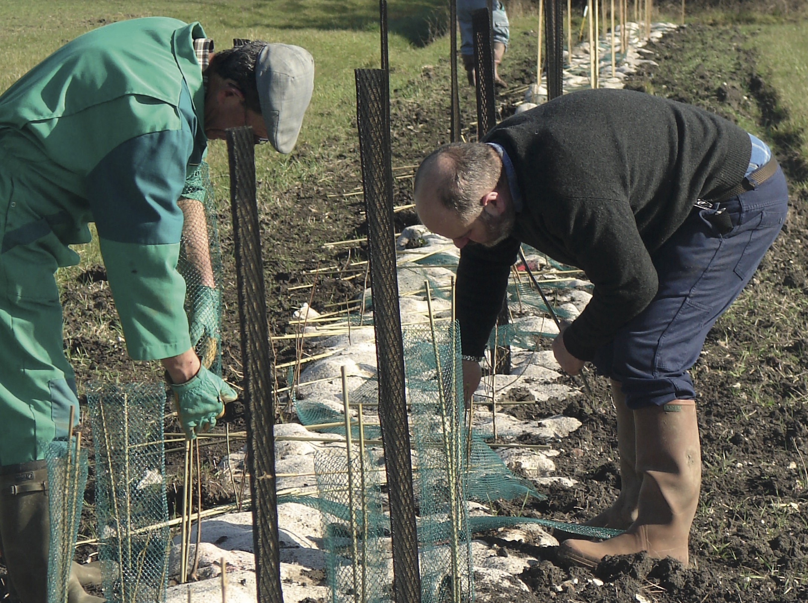

Conserver, restaurer ou planter des haies. Vous avez le pouvoir... Celui de changer le visage des paysages, de réintroduire de la biodiversité, d’afficher au grand public
votre amour pour vos terres et pour vos territoires. Une haie, c’est bien plus que quelques mètres carrés de végétation, c’est un tampon contre les aléas climatiques, un refuge pour les auxiliaires, un site pour les oiseaux nicheurs, une autoroute pour les chauves-souris, un maillage à l’échelle du territoire. C’est aussi un formidable outil de communication à mettre en avant !

<!--more-->

L’arrachage et la disparition des haies font partie des reproches régulièrement faits par le grand public au monde agricole. Mais plutôt que de s’attarder sur le passé, regardons devant. Changeons notre regard sur la haie, acceptons cette petite part de nature autour de nos parcelles.
Bien sûr, il ne faut pas non plus idéaliser la haie : c’est une contrainte en matière d’entretien. Mais il est possible de se faire aider, de maximiser les bénéfices des haies comme ressources énergétiques, de les mettre en avant au sein des activités d’accueil à la ferme. Il existe un véritable savoir autour des haies que nous avons peu à peu perdu, alors n’hésitez pas à vous former!

[Téléchargez le dossier complet au format PDF](/assets/ENJ34-light.pdf) (paru en mai 2021)

